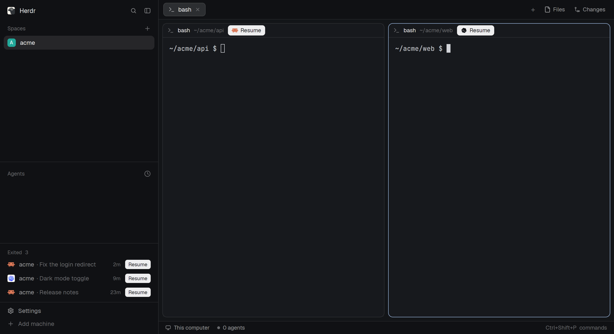

# Herdr Resume



A **Resume** button in the pane header of the [Herdr](https://herdr.dev) desktop app. Quit Claude Code or Codex, and one click brings that terminal's last session back.

- **The right session.** Each terminal remembers its own last session, so you never pick from a list.
- **Only when it helps.** The button shows while a shell runs in a terminal that has a session to go back to. While the agent runs, it's gone.
- **Your permissions stay.** A Claude Code session started with `--dangerously-skip-permissions` or `--permission-mode` comes back with the same flag.
- **Background runs don't count.** `claude -p`, `codex exec` and `codex review` never replace the session you were working in.
- **Back in the right folder.** Resume goes back to the folder the session ran in first, because Claude only finds a session from there. Wander off with `cd` after quitting and it still works.
- **Quit agents stay in the Agents panel.** With the optional Agents panel, an agent you quit stays under **Exited** for an hour, with its own Resume button. Closed the pane too? Resume opens a new tab for it.

## Install

You need Herdr with `hc`, and Claude Code, Codex or both.

```sh
git clone https://github.com/jankeesvw/herdr-resume.git
cd herdr-resume
cp -R mods/resume mods/agents-resume ~/.config/herdr-app/mods/
mkdir -p ~/.local/bin
install -m 755 hooks/herdr-resume-label ~/.local/bin/
```

### 1. Put the header on a layout

Herdr's own layouts are read-only, so clone `main` and point its pane header at this mod:

```sh
herdr-app do layout.clone '{"name":"main","as":"main-resume"}'
perl -pi -e 's/"mod": "pane"/"mod": "resume"/' ~/.config/herdr-app/layouts/main-resume.json
```

`ctrl-shift-l` switches back to any other layout. In a layout of your own, set the pane header of the tab block:

```json
{ "id": "main", "type": "block", "content": { "tab": "active",
  "pane": { "header": { "content": { "mod": "resume" }, "height": 30, "position": "top", "reveal": "always" } } } }
```

### 2. Add the hooks

For Claude Code, add this to `~/.claude/settings.json`:

```json
{
  "hooks": {
    "SessionStart": [
      { "hooks": [{ "type": "command", "command": "$HOME/.local/bin/herdr-resume-label claude", "timeout": 5 }] }
    ]
  }
}
```

For Codex, add this to `~/.codex/hooks.json`, then run `/hooks` in Codex and trust it. Codex skips a hook until you do.

```json
{
  "hooks": {
    "SessionStart": [
      {
        "matcher": "startup|resume|clear|compact|fork",
        "hooks": [{ "type": "command", "command": "$HOME/.local/bin/herdr-resume-label codex", "timeout": 5 }]
      }
    ]
  }
}
```

Agents that were already running get the button after their next session start.

### 3. The Agents panel (optional)

`agents-resume` is Herdr's own Agents panel with an **Exited** group pinned under the list, so a long Idle list never pushes it out of sight. An agent that quits stays there for an hour, with the time since it quit and a Resume button. Past three rows the group scrolls on its own.

- **Quit, pane still open:** Resume types the resume into that terminal, after a `cd` to the session's folder. Clicking the row goes to the terminal.
- **Pane closed** (`ctrl-space x`, which ends the terminal too): Resume opens a new tab in the same space, with the old tab's name, and starts the session there in its own folder.

Hover a row for a button that takes it off the list. A row goes away once the session runs again anywhere, when its open terminal runs something other than a shell, and when a closed terminal is removed with `hc rm`. A session that quit twice shows once.

Point the Agents block of your layout at it:

```json
{ "id": "agents", "type": "block", "content": { "mod": "agents-resume" } }
```

Set `"props": { "keepMinutes": 30 }` on that content to keep quit agents for another time than 60 minutes. To keep the times the panel shows, copy Herdr's store once before you switch: `mkdir -p ~/.config/herdr-app/data/agents-resume && cp ~/.config/herdr-app/data/agents/store.json ~/.config/herdr-app/data/agents-resume/`.

## Options

Set these as `props` on the header's content, for example `"content": { "mod": "resume", "props": { "focusToHover": true } }`.

- `focusToHover`: the pane under the pointer gets the keyboard, as in [Herdr Focus to Hover](https://github.com/jankeesvw/herdr-focus-to-hover). Off by default.
- `delay`: with `focusToHover`, the milliseconds the pointer rests before the pane gets the keyboard. Default 0.

## How it works

When a session starts, the hook stores it on the terminal with `hc label`: `session.resume=claude:<id>` or `session.resume=codex:<id>`, plus Claude's permission flags in `session.resume.flags` and the session's folder in `session.resume.cwd`. The header and the Agents panel read those labels. A click types `cd '<folder>' && claude --resume <id>` or `cd '<folder>' && codex resume <id>` into the shell with `hc send`. Labels are checked against a strict pattern first, because they end up on a command line: a folder with a quote or a control character is left out, and then the panel falls back to the folder it saw the agent run in.

## Known limits

- Only Claude's permission flags come back. Other flags like `--model` don't, and Codex resumes without its own flags.
- Sessions labelled before this version have no `session.resume.cwd` yet. The header then resumes where the shell is, until the next session start writes the folder; the Agents panel falls back to the folder it saw the agent run in.
- A closed pane on another machine, such as a workspace VM, isn't offered: its terminal also goes missing while that machine is away, and a resume there could start a session that still runs.
- `agents-resume` is a copy of Herdr's Agents panel (0.1.18). Changes Herdr makes to its own panel don't come along until the copy is updated.
- Tested on Linux. On macOS the hook falls back to `ps`, which splits quoted prompts on spaces, so a Codex session started with a prompt whose first word is `exec`, `e` or `review` gets no button.

## Tests

```sh
sh test/hook_test.sh
node --test test/
```

## License

MIT (`LICENSE`). The header and the Agents panel are copies of the pane and agents mods that ship with [Herdr](https://herdr.dev); that code keeps Herdr's Apache License 2.0 (`LICENSE-APACHE`).
