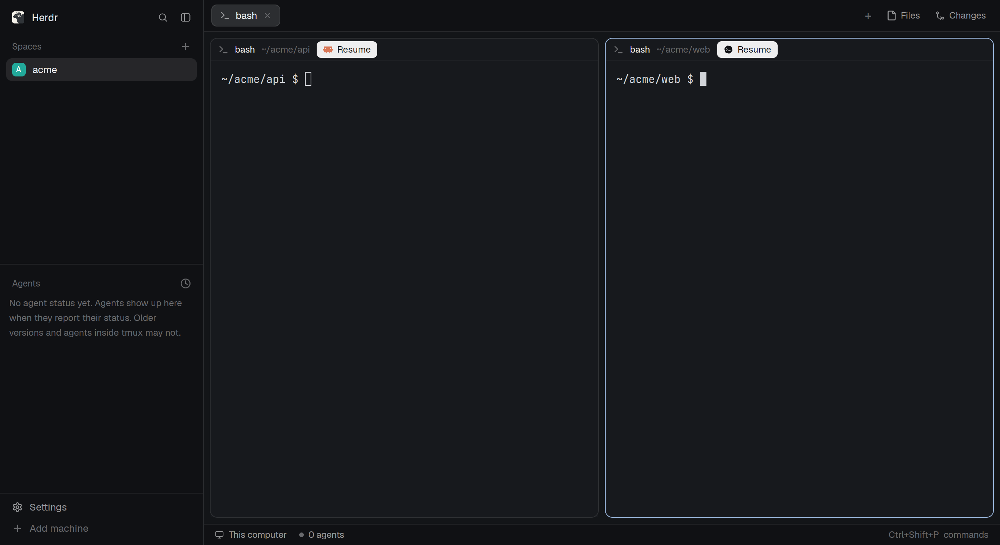

# Herdr Resume

A pane header with a Resume button: after you quit Claude Code or Codex in a terminal, one click right next to the folder brings that terminal's last session back, with Claude's permission flags.

## What you see

- **The pane header**, 30px, as in Herdr's own `pane` mod: the program's 14px icon, its name in `foreground`, the folder in `dim` with the home as `~`, then the agent's status on the right, and split, zoom and close buttons while hovered.
- **The Resume button**, directly after the folder: 22px high, 8px side padding, 6px corners, a 5px gap, on `solid` with `solid_foreground` text, 12px semibold. It holds a 14px provider glyph and the word "Resume". Claude's glyph is `#D97757`, Codex's is `solid_foreground`.
- A long folder truncates; the button keeps its size.

## How it behaves

- The button shows only while the terminal's program is a shell and its `session.resume` label is valid. With an agent running, or without a label, the header looks like Herdr's own.
- A click focuses the pane and types `claude [flags] --resume <id>` or `codex resume <id>` into the shell. A second click within 3 seconds does nothing, because it would land in the agent as a prompt.
- If sending fails, an error toast "Could not resume" shows the reason and the button works again at once.
- Hover turns the button `accent` with `accent_foreground`.
- Agent status is Herdr's: a spinner for working, "Needs you" for blocked, a dot for done, nothing for idle.
- With the prop `focusToHover: true`, the pane under the pointer gets the keyboard, after `delay` ms (default 0).

## Built from

- **Mod** `mods/resume/`: a copy of Herdr's `pane` (0.1.16) with `lastSession`, `resume` and `resumeButton` added. `follow.js` comes from `github.com/jankeesvw/herdr-focus-to-hover`. Its own glyphs are `claude.svg` and `codex.svg`, made from Herdr's icons.
- **herdr**: `panes`, `terminals` (for `labels`), `props`, `layout`, `theme`, `home`, `run` (`pane.focus`, `pane.split`, `pane.zoom`, `pane.close`), `hc` (`send`), `notify`.
- **Hook** `hooks/herdr-resume-label <claude|codex>`: a POSIX `sh` script for SessionStart in Claude Code and Codex. It reads `session_id` from stdin and `HC_TERMINAL_ID` from the environment, finds the nearest agent process above it, and runs `hc label <terminal> session.resume=<provider>:<id> session.resume.flags=<flags>`.
- **Layout**: any layout whose tab block has `pane.header.content.mod` set to `resume`.

## Watch out

- `herdr-app check` doesn't lay out or draw. Check the button with `herdr-app shot`.
- `flex_shrink()` needs a number. The folder uses `.flex_shrink(1).min_w(0).truncate()`, with a `flex_1` spacer after the button, so the button stays right after the folder.
- `image()` can stay blank when the button first appears, so the glyphs are one-color `svg()` with a text color.
- Codex fires SessionStart for `codex exec` and `codex review` too. Without a filter, those replace the session to resume. Find the subcommand by skipping options and their values.
- Codex skips a hook until it's trusted with `/hooks`.
- `hc send` from inside an agent's terminal wraps text sent to another agent in `<hc>` tags. From the app it doesn't.
- Herdr refuses a module that is a symlink to a file outside the mod folder. A symlink to the whole mod folder works, but then Herdr doesn't reload it when a file changes.
- A second Herdr window with its own `HERDR_APP_HOME` still shares the core's layout. Test with your own `HC_SESSION` and scratch XDG paths too.

## Done when

- `herdr-app check mods/resume` passes and `sh test/hook_test.sh` reports no failures.
- In a Herdr terminal, start `claude --dangerously-skip-permissions`, send one message and `/exit`: the button shows right after the folder with Claude's glyph.
- A click resumes that session, with the flag on the new process, and the button is gone while it runs.
- The same works for Codex after trusting the hook in `/hooks`.
- `codex exec` and `claude -p` in that terminal leave the label unchanged.
